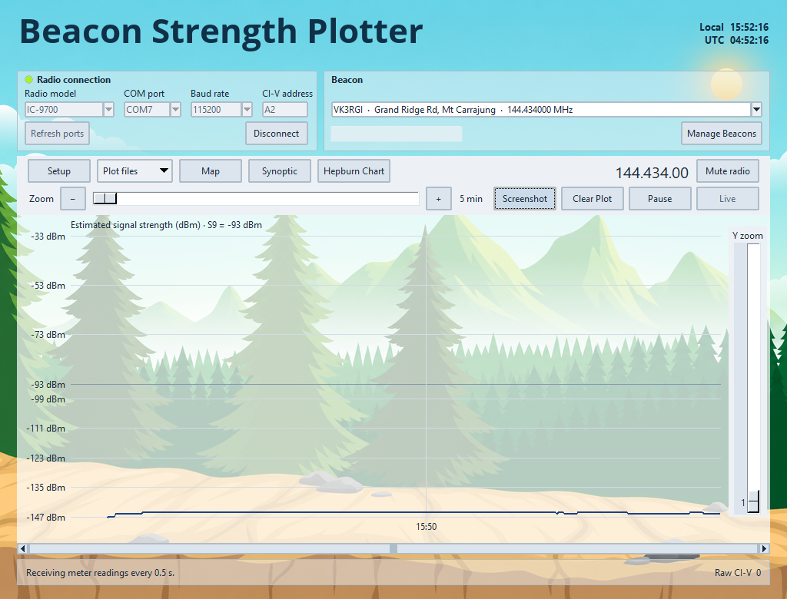

VK3FS Beacon Strength Plotter is a Windows program for monitoring and recording amateur radio beacon signals from Icom transceivers via CI-V. Plot live S-meter readings in S-units or estimated dBm, review signal history, and export readings to CSV.

[Download the Windows installer](https://github.com/AM3FS/Beacon-Strength-Plotter/releases/latest)

