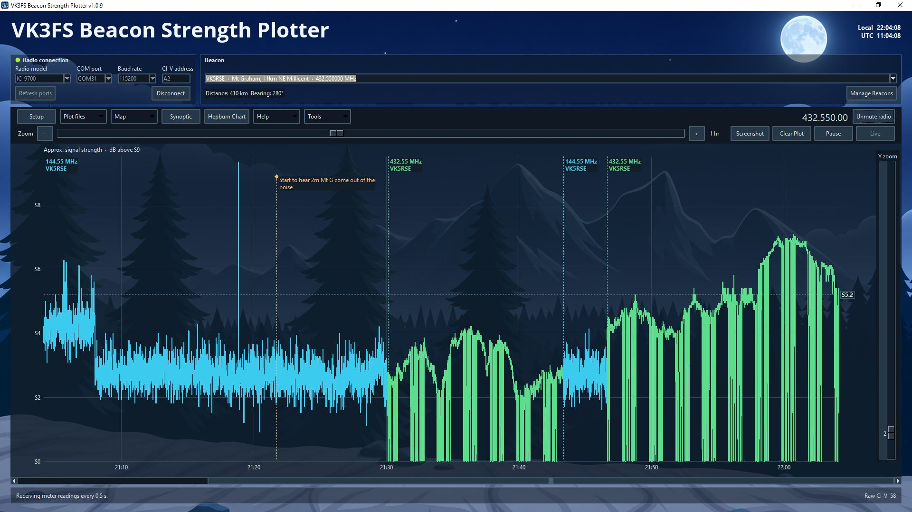

## What’s new

- **Reduced live plotting load.** The plotter groups same-colour trace segments, and the 24-hour view refreshes at most once a second.
- **Keep monitoring while minimised.** Live graph redraws pause while sampling, alerts and recording continue.
- **Yaesu FTX-1 and FT-891 support.** Connect through the Enhanced USB CAT COM port to plot and record live S-meter readings, mark frequency changes and tune saved beacons in CW. The FTX-1 monitors its Main receiver. Yaesu profiles display raw CAT counts (0–255) while calibration is pending.

## Install or update

Download **VK3FS-Beacon-Strength-Plotter-Setup.exe** from this release’s assets and run it on Windows 10 or 11.

## VK5RSE on 2 m and 70 cm

VK3FS monitoring VK5RSE over a 410 km path. Cyan marks 144.550 MHz and green marks 432.550 MHz. The Night-mode example shows frequency changes, a timestamped listening note and the latest S-meter reading. Captured in v1.0.9.

